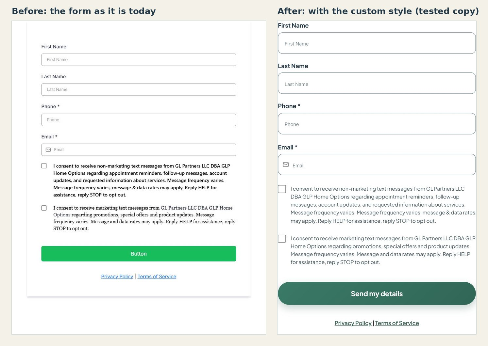

# Fixing the contact form's look (GoHighLevel)

**Why:** Jeremy, Oct 21, 11:09 PM: the questionnaire "looks like a third-party bolt-on, scammy, like an ad on top of the website." He is right. The form on the Home and Contact pages is GoHighLevel's plain default, in a frame (an iframe) from `links.voiseai.com`. Our site's CSS cannot reach inside it. Only someone who can open the form in GoHighLevel can change it.

**Who it is for:** ordinary homeowners, many short on money and time, who have seen a lot of "we buy houses" ads (Jeremy, Oct 21, 11:11 PM). The form has to look like it belongs to two local guys, not to an ad network. See `DESIGN_SYSTEM.md`, section 0.

## What is wrong (measured on the live form, Oct 21, about 11:15 PM)

| What | Today | Why it hurts |
|---|---|---|
| Button label | The word **"Button"** (the builder's placeholder), bright green `#18bd5b`, 5px corners | Looks unfinished and off-brand. This is the worst one. |
| A card inside our card | The form draws its own white card, with a shadow, 44px side margins and 40px padding | Our card already frames it, so it reads as a pasted-in box. |
| Fonts | Labels Inter 14px; fields Inter 12px; first consent in Segoe UI bold, second in Georgia serif with the company name in another color (inline styles) | Three fonts in one form. 12px fields also make iPhones zoom in when tapped. |
| Links | Default blue `#0d6efd` | Not our color. |
| Field borders | `#acacac`, about 2.3:1 against white | Below the 3:1 that WCAG asks of a field's outline. |
| First consent | "Message frequency varies." appears twice | Looks careless in a legal line. |
| Required fields | Phone and Email both marked required | A question for Joey: many people would rather give a phone number only. |

Good news seen at the same time: the consent text now names "GL Partners LLC DBA GLP Home Options" (no `[BUSINESS NAME]` placeholders left), and the Privacy and Terms links point to `glphomeoptions.com/privacy-policy` and `/terms-of-service` (the old site's pages; see "After launch" below).

## The fix: steps for whoever has GoHighLevel access (about 5 minutes)

Menu names in GoHighLevel move around a little. Look for the form builder and its Style panel.

1. Open the form (id `c36UOOc2pkosxfvRfjZJ`, "GLP Home Options lead form") in the form builder.
2. **Button text:** change "Button" to **Send my details** (or "Get my options", Joey's call). This is a setting, not CSS, and it matters most.
3. **Custom CSS:** paste all of `research/ghl-form-custom.css` into the form's Custom CSS box.
4. **First consent:** delete the repeated "Message frequency varies." Change nothing else in the consent wording. The text must keep matching the registered text-message campaign.
5. Save. Then, on a real phone, open the live Contact page and:
   - look at the form (one font, green button, no box inside the box);
   - tap a field (the page should not zoom in);
   - send **one test lead with a phone number you control**, and check it arrives where leads go and that the consent is recorded.
6. Tell Claude what you see. Claude cannot load the form inside its own browser tab, so it cannot check the page end to end.

## What the CSS does and does not do

- **Does:** removes the form's own card and margins, uses the site's font (loaded from our site, falling back to Inter), makes fields 54px tall with 12px corners and a visible border, makes the consent text one font, size and color, makes the button a green pill in our gradient, colors the links.
- **Does not:** change any wording, required flags, field order, the consent checkboxes, where leads go, or the form's behavior.
- **Tested:** on a throwaway copy of the live form page in a browser tab, at 500px wide (the form's width on a laptop screen), by adding the CSS to the page in the browser. Nothing was saved in GoHighLevel and nothing was submitted. Not tested: the error messages after a failed send, a phone width inside our page, and the form inside our page at all.
- **Why every rule repeats the id (`#_builder-form#_builder-form`):** the builder's own rules carry `!important` and are specific, and a normal rule loses to them. Repeating the id makes ours win.
- **If it ever looks off:** remove the pasted CSS and the form goes back to the default look. Nothing else depends on it.

## Check before pasting

- **Is this form also on the old site?** If `glphomeoptions.com` embeds the same form, the new look shows there too. If that matters, duplicate the form, paste the CSS into the copy, re-point the leads workflow, and change `FORM_ID` in `tools/build-pages.py`. If not, edit it in place.
- The font line points at `jsglisson3.github.io/GLP-Home-Options/fonts/...`. When the site moves to `glphomeoptions.com`, change that address. If the font fails to load, the form falls back to Inter and still looks fine.

## After launch

The consent text's links use `glphomeoptions.com/privacy-policy` and `/terms-of-service`. When the new site replaces the old one on that domain, those two addresses must still open the new Privacy and Terms pages (GitHub Pages serves `privacy-policy.html` at `/privacy-policy`, so they should). Check them then.

## Other options, not now

- **A form built into our own page** that sends the details to GoHighLevel. It would look perfect, but it needs a GoHighLevel workflow set up by someone with access, and we would have to rebuild the consent record and spam protection that the GoHighLevel form gives for free. A Session 11 decision, with Joey and a lawyer, not tonight.
- **Our side of the frame** (Session 6e+): a softer card shadow, Joey and Ethan's faces on the card, a calmer band. Listed in `ROADMAP.md`.
